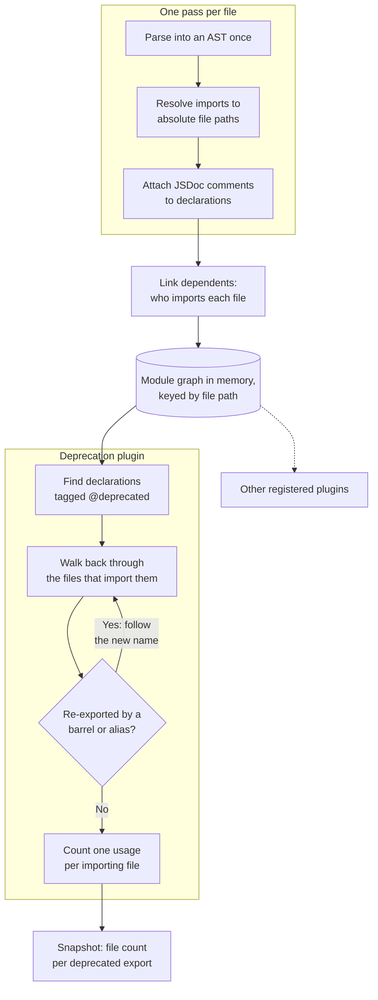
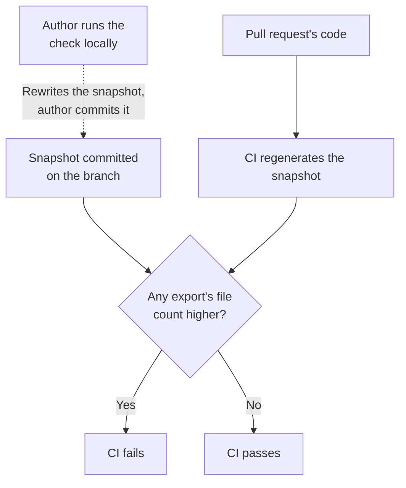

import { BarChart, LineChart, PieChart } from '~/components/charts'

When I joined the company at the end of 2024, the frontend had several implementations
of the same UI components: dropdowns, menus, selects. Nothing really said which one to use. I
remember wondering whether the date of each implementation's last commit would tell me,
before I gave up and asked colleagues what the recommended practice was.

Some components were marked as deprecated with a `DEPRECATED_` prefix, some with `@deprecated` comments. I was also surprised to keep seeing them in new PRs way too often. Having only just joined, I asked other senior/staff engineers why we were doing this to ourselves. The answer was a mix of three things that had built up over the company's ten years:

- There was no design system. Designers created new, incompatible versions of the same
  components instead of building on a common, stable set of design tokens and a library
  of reusable components.
- Code hygiene was an afterthought in the frontend. A lack of technical direction and decisions had left product engineers alone to handle the tradeoff between maintainability and delivery.
- There weren't enough engineers to fix it after the fact, by turning two similar but
  incompatible implementations into one reusable, extendable component.

So I proposed a policy, through an RFC and then an ADR, to stop the bleeding:
keep deprecated components out of new code, and document every deprecation so a
newcomer could tell which component to use. The policy wouldn't add engineers, so it had to work with the few we had: keep the problem from growing, and turn the cleanup into work we could plan. Enforcing it meant building a tool that reads the whole codebase, and that tool ended up doing a lot more than deprecations.

## The deprecation policy

### The policy

I wrote the RFC with these goals:

1. Agreeing that this was something we wanted to do something about.
2. Enabling decision making by surfacing the problem with actual data about deprecated code: what it is and how much of it we have.
3. Handling deprecated code as a project we could manage as an engineering organization, not something engineers had to deal with on their own while doing feature work.
4. Having a single way to mark deprecated code, track it and prevent additional usages of it.
5. Being in a position to report its evolution over time as part of other codebase health metrics to the engineering leadership if needed.

Deprecated code got a JSDoc tag instead of a prefix, so that IDEs could flag it _(in 2024 we still used them heavily)_, plus some optional contextual metadata for tracking and reporting.

```tsx
/**
 * @deprecated Use `Button` from the UI kit.
 * @date 2025-03-05
 * @type ui-kit-migration
 */
export function LegacyButton(props: LegacyButtonProps) {
  // ...
}
```

### The enforcement

We also needed a way to enforce that policy and to generate data that made migrations easier to execute and progress easier to report.

#### The static analysis tool

In order to prevent additional usages of deprecated code, I had to be able to resolve all its consumers and track them correctly within the module graph. So a traditional ESLint rule wasn't going to be enough, since lint rules apply at the file level rather than to the entire module graph.

This requirement led me to build our tool as a module-graph-oriented static analysis tool. It works in two phases:

1. It builds the entire module graph once.
2. It then runs every registered plugin against that graph in memory.

The graph itself is a map from absolute file path to module. The resolver turns every import into the same absolute path the map uses as a key, so following an import is a single lookup. Roughly:

```ts
type ModuleGraph = Map<FilePath, Module>

type Module = {
  filePath: FilePath
  ast: Program // parsed once, kept for the plugins
  imports: Import[] // each with the resolved path of the file it points to
  exports: Export[]
  dependencies: Set<FilePath> // files this module imports
  dependents: Set<FilePath> // files that import this module
  documentedNodes: { node: Node; comment: Comment }[]
}
```

The plugin API is deliberately minimal:

1. Plugins get the `ModuleGraph` and an AST walking utility.
2. The reporting API is bare-bones, to leave that concern to the consumer.

```ts
export type ModuleGraphPlugin<R = unknown> = {
  name: string
  apply(baseParams: { ModuleGraph: ModuleGraph; walk: /* AST walking utility */ }): R
  report(params: R): void
}
```

#### The deprecation plugin

The deprecation plugin picks the documented nodes whose comment contains `@deprecated`, finds the names their file exports them under, and walks the `dependents` sets to build the list of consumers that will require a migration.



The static analysis tool lets consumers choose how best to handle each plugin's results. In our case, CI regenerates the snapshot, compares each deprecated export's file count with the snapshot committed on the branch, and fails the pull request if a count rose.



## What happened

Deprecated code stopped spreading into new code by default. Importing a deprecated component fails CI, and engineers who really need to can override that failure by updating the snapshot. Over time, we kept deprecating code and progressively cleaning it up when we had the bandwidth.

<BarChart
  client:visible
  filterable
  title="Usages entering and leaving the deprecated count, by month"
  index="month"
  series={{
    deprecated: 'Newly deprecated',
    removed: 'Removed',
  }}
  data={[
    { month: '2025-02', deprecated: 217, removed: 0 },
    { month: '2025-03', deprecated: 928, removed: 132 },
    { month: '2025-04', deprecated: 78, removed: 22 },
    { month: '2025-05', deprecated: 0, removed: 20 },
    { month: '2025-06', deprecated: 14, removed: 47 },
    { month: '2025-08', deprecated: 47, removed: 566 },
    { month: '2025-09', deprecated: 7, removed: 125 },
    { month: '2025-10', deprecated: 1110, removed: 60 },
    { month: '2025-11', deprecated: 0, removed: 4 },
    { month: '2025-12', deprecated: 631, removed: 30 },
    { month: '2026-01', deprecated: 1569, removed: 182 },
    { month: '2026-02', deprecated: 287, removed: 49 },
    { month: '2026-03', deprecated: 716, removed: 48 },
    { month: '2026-04', deprecated: 1858, removed: 339 },
    { month: '2026-05', deprecated: 0, removed: 1304 },
    { month: '2026-06', deprecated: 0, removed: 367 },
    { month: '2026-07', deprecated: 573, removed: 162 },
    { month: '2026-08', deprecated: 144, removed: 253 },
    { month: '2026-09', deprecated: 12, removed: 389 },
  ]}
/>

The count went from 264 usages in January 2025 to 5,914 at the end of September 2026:
8,191 newly deprecated and 4,099 removed, plus 188 new usages of code already deprecated
and 1,370 from scanner changes that counted existing code differently.

So far, 93 deprecated entries, with 2,922 usages between them, were fully cleaned up.

| Export               | Peak | Deprecated | Reached zero |
| -------------------- | ---: | ---------- | ------------ |
| Local `Button`       |  613 | 2025-03-05 | 2025-09-04   |
| `NotificationStatus` |  488 | 2026-04-27 | 2026-07-28   |
| `notify`             |  485 | 2026-04-27 | 2026-07-28   |
| `renderWithRouter`   |  341 | 2026-04-27 | 2026-05-01   |
| `useFlags`           |  217 | 2025-02-11 | 2025-10-27   |
| `renderWithStore`    |  137 | 2026-04-27 | 2026-05-01   |
| `useLocalStorage`    |   96 | 2026-08-05 | 2026-08-10   |

Velocity varies a lot. Tooling deprecations can be cleaned up very quickly once we've agreed to do it, since the production impact is null. On the other hand, cleaning up deprecated user-facing components in a ten-year-old codebase takes a bit more care and time.

<LineChart
  client:visible
  filterable
  title="Usages left after deprecation, by week"
  index="week"
  unit="%"
  series={{
    button: 'Local Button',
    notify: 'notify and NotificationStatus',
    flags: 'useFlags',
    helpers: 'Test render helpers',
  }}
  data={[
    { week: 0, button: 100, notify: 100, flags: 100, helpers: 97 },
    { week: 1, button: 100, notify: 82, flags: 100, helpers: 0 },
    { week: 2, button: 100, notify: 82, flags: 100, helpers: 0 },
    { week: 3, button: 97, notify: 82, flags: 100, helpers: 0 },
    { week: 4, button: 96, notify: 35, flags: 94, helpers: 0 },
    { week: 5, button: 96, notify: 35, flags: 94, helpers: 0 },
    { week: 6, button: 95, notify: 35, flags: 94, helpers: 0 },
    { week: 7, button: 95, notify: 35, flags: 88, helpers: 0 },
    { week: 8, button: 95, notify: 24, flags: 88, helpers: 0 },
    { week: 9, button: 95, notify: 7, flags: 90, helpers: 0 },
    { week: 10, button: 95, notify: 7, flags: 90, helpers: 0 },
    { week: 11, button: 92, notify: 4, flags: 90, helpers: 0 },
    { week: 12, button: 92, notify: 4, flags: 90, helpers: 0 },
    { week: 13, button: 90, notify: 4, flags: 90, helpers: 0 },
    { week: 14, button: 90, notify: 0, flags: 91, helpers: 0 },
    { week: 15, button: 90, notify: 0, flags: 91, helpers: 0 },
    { week: 16, button: 90, notify: 0, flags: 81, helpers: 0 },
    { week: 17, button: 90, notify: 0, flags: 80, helpers: 0 },
    { week: 18, button: 90, notify: 0, flags: 80, helpers: 0 },
    { week: 19, button: 90, notify: 0, flags: 80, helpers: 0 },
    { week: 20, button: 90, notify: 0, flags: 80, helpers: 0 },
    { week: 21, button: 90, notify: 0, flags: 80, helpers: 0 },
    { week: 22, button: 87, notify: 0, flags: 80, helpers: 0 },
    { week: 23, button: 80, notify: 0, flags: 80, helpers: 0 },
    { week: 24, button: 51, notify: 0, flags: 80, helpers: 0 },
    { week: 25, button: 4, notify: 0, flags: 80, helpers: 0 },
    { week: 26, button: 4, notify: 0, flags: 79, helpers: 0 },
    { week: 27, button: 0, notify: 0, flags: 79, helpers: 0 },
    { week: 28, button: 0, notify: 0, flags: 75, helpers: 0 },
    { week: 29, button: 0, notify: 0, flags: 70, helpers: 0 },
    { week: 30, button: 0, notify: 0, flags: 24, helpers: 0 },
    { week: 31, button: 0, notify: 0, flags: 24, helpers: 0 },
    { week: 32, button: 0, notify: 0, flags: 24, helpers: 0 },
    { week: 33, button: 0, notify: 0, flags: 24, helpers: 0 },
    { week: 34, button: 0, notify: 0, flags: 24, helpers: 0 },
    { week: 35, button: 0, notify: 0, flags: 21, helpers: 0 },
    { week: 36, button: 0, notify: 0, flags: 17, helpers: 0 },
    { week: 37, button: 0, notify: 0, flags: 0, helpers: 0 },
  ]}
/>

Most of what we kept deprecating came from the design system effort we started, which led us to replace old, inconsistent, non-WAI-ARIA-compliant UI components with new ones built on top of defined design tokens and open-source WAI-ARIA headless UI primitives.

## What the tool became

I started the scanner at the end of 2024 to organize how people worked together on
deprecated code, and to make the codebase enforce decisions we had already made. Back
then, the cleanup was going to move at the speed of our engineering capacity.

The scanner still marks deprecations, but it now does two more jobs.

It tracks code quality and performance beyond deprecation. The same module graph now
runs 15 more plugins:

- Type narrowing and component APIs: flagging opaque prop types that should become
  discriminated unions.
- Migrations a `@deprecated` tag can't mark: legacy API clients, legacy generated
  clients, hand-written React Query hooks instead of our internal SDKs, code that bypasses internal
  libraries, and imports of deprecated design system components.
- Render performance: props that defeat `memo`, context providers that re-render every
  reader, selectors that return a new reference on every call, lookups rebuilt on every
  render, nested list scans, and per-row work in lists. A route-reach plugin counts how
  many routes reach each file, so findings on hot pages rank first.

It also plans migrations. Before a migration, a coding agent writes a throwaway plugin
to take an in-depth snapshot of the code the migration will touch. From that snapshot,
the agent splits the work into Linear issues, and cloud coding agents pick them up and
execute them.
